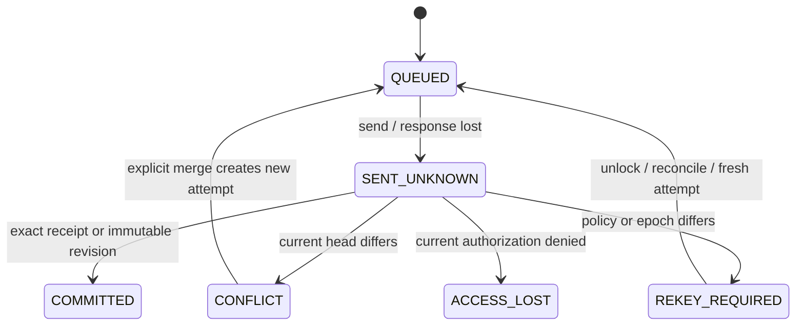

# Complete P02 v1 design contract

This document completes the P02 design deliverables in original chapter 14 §5.
It composes the exact identity, state, file and group contracts with the closed
`p02-v1.schema.json` and mandatory predicates in `protocol-codec.mjs`. This is a
reviewable development protocol, not production security approval. The review
is tracked in `P02_REVIEW.md` / `p02-review.json`; no reviewer is booked and no
qualified review has taken place. P05 implements product crypto adapters, P07
actual custody, P04/P08/P11 durable authorization/sync, P13 the full offline
utility and P17 the release review. Those gates are not completed by P02.

## Profile and normative encoding

The negotiated component list, in this exact order, is `p02-file-c1`,
`p02-identity-c1`, `p02-state-c1`, `p02-group-c2`, `p02-v1`. Every version in the
negotiation record is integer 1. Reject a missing/different component, unknown
version or field; do not downgrade. Candidate markers are mandatory and never
implicitly interpreted as a production release. `p02-group-c1` remains a separate
legacy ten-member evaluation profile; c2 permits the required twenty members,
uses different hash/signature domains and cannot reinterpret a c1 signature.
Earlier schemas, registries, vectors, locks and supplied specification stay intact.

All JSON follows RFC 8785 using maintained canonicalize 5.1.0. Require raw valid
UTF-8, no BOM, duplicate properties, malformed Unicode, comments, trailing comma,
nonfinite number or unknown field. Maximum nesting is 32. IDs are exactly 16 bytes,
digests/keys 32, Ed25519 signatures 64, XChaCha nonces 24, AES-GCM nonces 12, encoded
as canonical unpadded base64url. Counters are decimal strings in [0, 2^63−1], no
leading zeros, sign or exponent. Memory/operation parameters are bounded integers.
Unicode title/tag limits count scalars, while resource limits count UTF-8 bytes.
No locale sorting or Unicode normalization is applied.

New domains are literal UTF-8 `AnyNote/p02-v1/{family}/{purpose}` followed by one
NUL byte. A typed hash is SHA-256(domain(`hash`, registry kind) || JCS(record)).
`rawDigest` is plain SHA-256 over original binary bytes, base64url encoded. Ed25519
signs domain(`sign`, body's purpose) || JCS(body), not a signature-bearing wrapper.
AAD is domain(`aad`, purpose) || JCS(the exact value specified below).
Do not concatenate variable strings without their typed JCS container.

Control headers/wrappers/receipts and ordinary records are capped at 64 KiB;
note plaintext is at most 2 MiB canonical bytes; bundles, drafts, outbox and local
plaintext at most 4 MiB wire bytes. Local ciphertext records permit 6 MiB for
base64 overhead and their bound context. Sync/snapshot/export inventory pages
have both 1 MiB and item ceilings. Public export evidence has a separate 16 MiB
ceiling per evidence document. These are parser ceilings, not mobile RAM claims.
Public evidence, key/cache records and inventories must be bounded and paginated
rather than multiplying a per-object limit into an unbounded HTTP response.

## Notes, metadata, trash and relationships

`context` binds service, group, object kind/ID, revision/operation IDs, author
account/device/root/generation/roster, exact policy/epoch/history reference,
thread ID, action, parent envelopes, attachment versions, schema and archive flag.
An entry requires a thread; group/thread metadata has no thread or attachments.
Parents are strictly ordered by revision ID, at most 32, no duplicate/self-parent;
attachments are ordered by file ID/version, at most 100. Create has no parent;
update/soft-delete/restore has at least one. Accepted parents must belong to the
same object kind, object and group, and match exact envelope digests. A new
publication must CAS the complete current head set; a stale draft is preserved
for explicit merge, never silently discarded or published under a new identity.

`payload` repeats the complete context. Titles (256 scalars), ordered unique tags
(50 × 64 scalars), Markdown, ordered checklist IDs/text/checked flags, optional
summary entry and ordered preference records are encrypted. Group/thread metadata
cannot masquerade as an entry body; entries cannot carry account preferences.
Preferences belong only to the hidden private group, checked against verified
group kind after decryption. Group metadata requires owner authority; thread and
entry content requires owner/editor. Reader has no publication privilege. Private
namespace visibility and referenced thread/attachment existence require product
transaction checks; the signed placement context does not itself create a thread.

Soft-delete is a signed revision with empty title/text/tags/checklist/preferences
and no summary, retaining context and parent closure. Restore is a new signed
revision descending from its tombstone. Archive state is signed; group archive
also gates writes through the group policy engine. Keep all accepted revision and
tombstone evidence; pruning payload does not erase its signed provenance.

Each immutable revision receives fresh independent random DEK32, payload nonce24
and wrap nonce24. Encrypt JCS(payload) with XChaCha20-Poly1305 under DEK and AAD
(`object-payload`, `{context}`). Wrap DEK under G[epoch] with AAD
(`object-key-wrap`, `{context}`), producing exactly 48 bytes. The typed wrap has
purpose `object-key-wrap`; its typed hash is signed in the header. The header
purpose `object-revision` also signs payload nonce, observed ciphertext byte
count and raw ciphertext SHA-256. Verify current/historical author proof,
signature, context, wrap commitment, size/digest, both AEADs, decrypted schema and
repeated context before displaying anything. No caller-supplied SQL role, valid
AEAD, certificate alone or knowledge of G upgrades a reader to a writer.

Private group proof handles share c2's full policy/roster/epoch/history evaluator.
Historical acceptance requires an exact independently witnessed/pinned inventory
record and the author's active historical roster and writer role. Current reader
must still be authorized to retrieve keys. Unknown history remains quarantined;
backdated signatures and server timestamps do not prove acceptance. Independent
pins detect known rollback/fork, not globally newest state. Existing identity
signature-only helpers retain `authorization=NOT_EVALUATED`.

## Local vault, unlock and offline custody

Generate independent random L32 per service/account/device/profile; never derive
L from R, a login passkey or an application server key. `local-context` binds all
four identities, record ID, record kind and local schema 1. Encrypt typed canonical
`local-plaintext` under L with a fresh nonce24 on every write, AAD (`local-record`,
local-context). Verify trusted expected context and repeated decrypted context.
Kinds are vault-secrets/cache/search/draft/outbox/transfer/session. Dedicated
schemas enforce draft/outbox/session semantics; typed cache/search/transfer
records remain encrypted. Cache names its signed object/file/public-evidence kind
and reparses its exact bytes; search schema 1 binds ordered group/object/revision
documents and bounded tokens; transfer binds direction/state/immutable file and
upload IDs, source size/hash, processed plaintext count, ordered verified
ciphertext parts and encrypted DEKs/nonce prefix. None of these records grants
authority, and source/remote resume must reverify exact immutable framing.
Per-record key tables have a 660-entry bound and must be sharded as necessary.
Vault records permit device signing/encryption secrets and G epochs; never R,
root signing/recovery private keys or a shared administrator recipient. Account
recovery is a deliberate separate ceremony with practical memory clearing.

Phrase wrapper: libsodium `crypto_pwhash(32, UTF8(phrase), salt16, opslimit,
memlimit, ALG_ARGON2ID13)`, salt random16, opslimit 3–10, memory 64–256 MiB,
no silent weakening. Reference policy admits well formed UTF-8 phrases of
24–1024 bytes and at least five whitespace-separated words; this minimum is
not a claimed entropy estimator. Admit one KDF job before allocation. Persist
parameters in the descriptor; AEAD AAD (`local-unlock`, `{context,parameters}`)
binds profile, wrapper ID and method. Wrap L with nonce24/XChaCha, ciphertext48.

PWA PRF wrapper: obtain a verified 32-byte credential PRF result from the platform;
it is not the authentication assertion or a server bearer token. KEK is
HKDF-SHA-256(IKM=PRF32, salt=prf_salt32, info=literal
`AnyNote/p02-v1/hkdf/local-prf-kek\0` || JCS({context,credential_id}), length32).
Descriptor is `{context,credential_id,prf_salt}`. Wrap L with XChaCha/nonce24,
AAD (`local-unlock`, descriptor). Credential ID is canonical base64url ≤1024 bytes.
Wrong credential/profile/salt fails; absent/ineligible PRF needs the explicit
strong-phrase route. Login success never implies content unlock.

Windows byte profile uses `windows-hello-webauthn-prf-tpm`, provider_format 1,
verified credential ID, PRF salt32, TPM SHA-256 Name (34 bytes: big-endian 0x000B
then digest32), TPM public SHA-256 and machine binding ID. The descriptor is all
wrapper fields except nonce/ciphertext. KEK is HKDF-SHA-256(PRF32, salt=prf_salt32,
info=`AnyNote/p02-v1/hkdf/windows-prf-kek\0` || JCS(descriptor), length32).
AES-256-GCM wraps L with random nonce12, AAD (`local-unlock`, descriptor), output
ciphertext32 || tag16. This freezes bytes only: values must come from actual
verified provider/per-key TPM evidence, fresh authorization, native handles and
lock/process generations. A renderer cannot assert eligibility or submit keys.
The P01 probe's synthetic AAD is never a product wrapper. P05/P07/P14 must connect
and revalidate the preserved working provider/lifecycle approach. Native byte
vectors in Node/PHP are not physical Hello acceptance or hardware attestation.

Lock/reload/suspend invalidates the generation before asynchronous results can
publish. Drop pending plaintext/key results and practical copies, retain encrypted
outbox/cache, require a fresh unlock. JS/WASM/GC cannot guarantee zeroization.
Session access/refresh credentials are local-encrypted, never plaintext database
cache; revoke/reset/restore must invalidate actual server sessions independently.

## Mutation, sync, snapshots and restored-server state

Draft ID survives edits; each publication attempt has immutable operation ID,
revision ID, signed bytes, nonce/DEKs and typed bundle digest. Outbox states are
QUEUED, SENT_UNKNOWN, CONFLICT, REKEY_REQUIRED, ACCESS_LOST, COMMITTED. Transport
uncertainty never proves noncommit. Reconcile a receipt or the immutable revision;
after receipt expiry retry identical bytes/preconditions, never regenerate an
attempt secretly. Changed body with retained idempotency key is 409; immutable
revision IDs still detect conflicts after receipt compaction. Receipts bind
operation/revision/envelope/cursor and COMMITTED, but are transport assertions,
not independently signed proof of durability or global freshness. Local outbox
COMMITTED requires the exact matching receipt. Current auth precedes replay.
Already committed attempts reconcile under current account/device/group **read**
authorization, even after writer-role loss/rekey; their old preconditions do not
become a new publication check. Removal/revoked sessions still deny receipt
access. A new attempt requires current writer authority and exact heads. The
model callback names publish/reconcile and must bind the actual requester;
request-body author fields never supply an authenticated session. Observed
ciphertext size/hash and key-wrap commitment are checked before commit.

Product commit transaction order is: authenticate bound active account/device
session; lock account/security roots in sorted IDs, relevant roster/policy/epoch
rows and object heads; recheck expected heads, role, descendants and staged
inventory; validate immutable request/signatures/limits; reserve/reconcile quota
where applicable; then lock transport generation/counter **last**, assign the
next sequence, store immutable objects, receipt and complete events atomically;
commit before response. All mutations, including removals/rekey/reset, follow
this order. Failed/deadlocked transactions publish no cursor/receipt/partial
coverage; retry with bounded backoff only when outcome is known, else reconcile.
Stage pages outside long locks. Durable SQL/restarts are subsequent-phase tests;
the in-memory model proves only admission and synchronous all-or-nothing ordering.

Cursor is `{generation,sequence}`. A page binds from/next/watermark; events have
contiguous sequence >from and ≤watermark. Complete requires next==watermark.
Page limits: default 200, maximum 1000 and 1 MiB; separate immutable ciphertext
fetches avoid returning 1000 large notes inline. Retention expiry or generation
mismatch requires a full snapshot, never a missing-event guess.

Snapshot descriptor binds account/device/purpose/opaque ID, committed watermark,
creation/expiry, page/item counts and inventory commitment. Pages order items by
`group_id/object_kind/object_id/revision_id`, at most 500 and 1 MiB. No empty page.
References/GC pins become effective before exposing the token. Every page fetch
and lease renewal reauthorizes current session/membership; revocation defeats an
old token. Resync lease ≤30 minutes; export ≤24 hours since creation, at most one
active export/account. No HTTP request holds an open SQL read transaction.
Only a verified complete snapshot can infer absence, replace cache or release
references; preserve outbox and independent cryptographic pins, then replay after
watermark. Failure/expiry never clears local drafts or silently skips records.

Snapshot/export inventory commitment is SHA-256(domain(`hash`,
`{snapshot|export}-inventory`) || uint32be(page_count) || uint64be(item_count) ||
for each page: uint32be(index) || uint32be(items) || uint32be(JCS byte length) ||
32-byte typed page hash). Empty inventory has zero counts and no pages. Across
pages enforce scope, indices, ordering/uniqueness and greedy packing (take the
next record unless 500 or the 1 MiB canonical-byte limit would be exceeded).
Maximum 8000 pages / 4,000,000 export/snapshot items; group retained-history
checkpoint uses the separately frozen bounded file checkpoint profile. Aggregate
reference budgets remain smaller than theoretical maxima; larger product
verification must stream/stage without replacing these commitments.

Restore starts isolated, revokes all restored credentials/sessions, generates a
fresh transport generation and enters RESTORE_QUARANTINE / recovery-only mode.
Reconcile signed security heads with independently held surviving client/operator
pins and current external revocations before admitting ordinary reads/writes.
An old restored membership/roster or transport watermark cannot reactivate a
revoked account. Unresolvable ambiguity stays quarantined; recover authorized
content into deliberately fresh verified state instead. Persist the independent
restore fence outside the rolled-back database/backup set. Product P16 exercises
this operational boundary; a restored SQL flag is not cryptographic freshness.

## Portable age export and offline import

Select maintained Rust age 0.12.1 (rage 0.12.1) as native library candidate,
MIT OR Apache-2.0, with independent Go age 1.3.2 BSD-3-Clause interoperability.
Use standard age v1 X25519 recipient encryption and authenticated stream EOF;
no custom cipher, compression, password recipient, plugin or plaintext ZIP.
Pinned release binaries/checksums are synthetic Linux test tools, not product
shipping artifacts. No upstream signature/Sigsum verification is claimed by a
TLS/GitHub-digest check. Product integration/license/SBOM remains P05/P13/P18.
Fresh independent age X25519 identity per new export, with human-preserved separate
recovery document. Restart an interrupted whole archive with a fresh identity
and .partial file; no arbitrary append/resume of age internal state.

Inner archive is **USTAR anynote v1**. Each entry is a regular file, type `0`,
mode 0600, uid/gid/mtime 0, empty uname/gname/linkname/prefix/device fields,
`ustar\0`, version `00`. Numeric fields are zero-padded octal with NUL;
checksum is six octal digits, NUL, space, computed with eight checksum spaces.
Body padding to 512 is zero. End is exactly two zero blocks, no trailing byte.
Reader compares the entire 512-byte header to the canonical profile. Reject
PAX/GNU/sparse metadata, links, devices, traversal, executable hooks, unknown
paths, duplicates, nonzero padding, overflow, extra footer-following entries or
trailing age data. Never extract using user paths or original filenames.

Entry order is header first, all data entries lexicographically by generated
ASCII path, inventory pages by index, footer last. Allowed generated paths:

| Path | Bytes / meaning |
| --- | --- |
| export-header.json | typed header, ≤64 KiB |
| identity/evidence.json | bounded compact public evidence option for small exports, ≤16 MiB |
| identity/accounts/{account_id}/identity.json | closed contact card / root evidence, ≤64 KiB |
| identity/accounts/{account_id}/roster/{8-digit-index}.json | exact signed roster event, ≤64 KiB |
| identity/groups/{group_id}/genesis.json | closed public genesis/pin, ≤64 KiB |
| identity/groups/{group_id}/journal/{8-digit-index}.json | ordered policy or epoch commit, ≤1 MiB and component limits |
| identity/groups/{group_id}/grants/{operation_id}/{8-digit-index}.json | exact signed grant page, ≤1 MiB / 500 records |
| identity/groups/{group_id}/history/checkpoint.json | exact signed history checkpoint, ≤64 KiB |
| identity/groups/{group_id}/history/pages/{8-digit-index}.json | exact known-history inventory page, ≤1 MiB / 500 records |
| records/{revision_id}.json | original note bundle or typed original file record, ≤4 MiB; pruned record carries original signed envelope only |
| keys/{revision_id}.json | selected object/manifest DEK and optional separate file-data DEK, ≤64 KiB |
| files/{file_version_id}/{8-digit-index}.bin | original encrypted chunk, ≤8,388,624 bytes |
| snapshots/{8-digit-index}.json | complete selected immutable source snapshot pages, ≤1 MiB |
| inventory/{8-digit-index}.json | typed export listing page, ≤500 items / 1 MiB |
| export-footer.json | signed final footer, ≤64 KiB |

Header binds export ID/service/exporter account/root, source snapshot/watermark,
creation and selection (ordered group IDs, current-only/full history, trash).
Source pages commit the exact selected retained/pruned/tombstone revisions; do
not omit missing source bytes. Current-only forbids an ancestor superseded in
the complete known history index; excluding trash forbids tombstone payloads.
Each selected record must match source item, independently accepted envelope,
object/group/version, author evidence and requested selection. Pruned evidence
cannot manufacture a missing payload and has no DEK/chunks.

Large exports use the paginated public-evidence layout; compact and paginated
evidence are mutually exclusive. Account/group IDs must match paths; all roster,
journal, grant and history indices are contiguous from zero. Journal order replays
policy/epoch transitions; epoch operation ID selects its exact signed grant pages.
Reject absent/unused/duplicate evidence. Product P13 streams or encrypted-stages
these bounded entries rather than collecting an unbounded metadata document;
the evaluation assembler explicitly caps aggregate evidence at 16 MiB.

Public evidence includes every selected cross-account author identity, certified
roster ancestry, signed policy/epoch transitions and historical inclusion closure,
not just exporter certificate. Independently stored kit carries expected exporter
root/roster, export ID, age identity, final archive SHA-256 and exact independent
group genesis/policy/epoch/history pins. Embedded identities are self assertions;
they cannot replace the kit/pin ceremony. Unknown historical authorization remains
quarantined and cannot become new live authority. No R, root/recovery/device
private key, G, session credential or general master key is exported. DEKs are
plaintext only inside already encrypted age and protected processing memory.

Export pages list exact path/kind/size/raw SHA-256 of all data entries, including
public evidence/source pages/selected key rows. Header, listing pages and footer
are excluded from that data inventory, preventing recursive commitments. Footer
signs export ID, typed header hash, inventory commitment/counts, total data bytes
and certified exporter author under domain(`sign`, `export-footer`). Check the
exporter against the independently pinned account/roster; recipient encryption
alone never authenticates authorship. Complete only after flush, authenticated
age EOF, footer, exact inventory, selected key path, all source relationships,
author signatures and historic acceptance; independently save final age digest.

Maximum total observed uncompressed archive bytes is
**100,000,000,000 + 16 GiB = 117,179,869,184**, including headers/padding/footer.
At most 4,008,003 tar entries, 4,000,000 data inventory items and 8000 listing
pages; all counters must also satisfy u63. This explicitly permits the agreed
100 GB ciphertext corpus plus bounded public metadata/key/inventory framing.
Available disk must cover encrypted staging/final output and actual temporary
space. Source quota still counts original committed ciphertext. Fetch through
one authorized pinned export snapshot, recheck access for every immutable object
and lease renewal. Pins do not bypass later membership/device revocation.

Import authenticates the independent kit/archive digest, full age EOF, canonical
USTAR/footer/inventory, all historical evidence and exact selected DEKs before
any live mutation or verified plaintext output. Use two passes on a seekable
archive or app-owned encrypted staging under a temporary L; never write inner
keys to a plaintext temporary directory. Default destination is a new private
group with fresh IDs/DEKs/current epoch; original provenance remains separate
from new destination-author signatures. Space/cancel/fault/unknown evidence keeps
live destination unchanged and cleans only owned staging. Merely decrypting early
age chunks or importing an embedded identity is not a completed import.

The synthetic reference has a **16 MiB collection / 64 KiB file** evaluation cap.
It verifies clean offline note/file recovery from only frozen age bytes and kit,
with Rust↔Go interoperability, zero filesystem extraction/live destination writes,
and no original G/uploader secret/cache/server in the reader. It is not a claimed
1 GB/100 GB product utility, atomic SQL import, actual disk-space fault or phone
memory acceptance. USTAR's streaming parser/writer contract and large bounds are
frozen; P13 must implement and measure the full utility without reducing limits.

## Errors, reproducibility and review

`p02-errors.json` fixes every original API error's HTTP/message/retry behavior.
Local-only INTEGRITY_FAILURE / EXPORT_TRUNCATED / EXPORT_INTEGRITY_FAILURE have
no HTTP status. Only bounded-backoff errors set retryable=true; authenticate,
reconcile, explicit restart/free-space actions are not blind retries. First
conceal unauthorized existence with NOT_FOUND/404. Error schema rejects stack,
SQL/path/token fields and inconsistent code/message/retry combinations.

Run `npm --prefix packages/protocol run complete:check`, protocol tests, Python
portability, native PHP complete/authority checks and all old frozen checks.
`schema-vectors.json` references exact PUBLIC hex byte blocks cut between complete
JSON values; each block is ≤8192 bytes and never splits a key/value. This keeps
independent bytes inspectable while avoiding upstream decoded-chunk truncation
false positives. Decoder/reassembler checks kind/path/size and full commitment.
All complete PUBLIC secret-scanner exceptions must match exact known values;
changed fields, encoded mutations, fake tokens and alternate age keys still fail.
Writers are deliberate development tools and never run during setup/CI.
