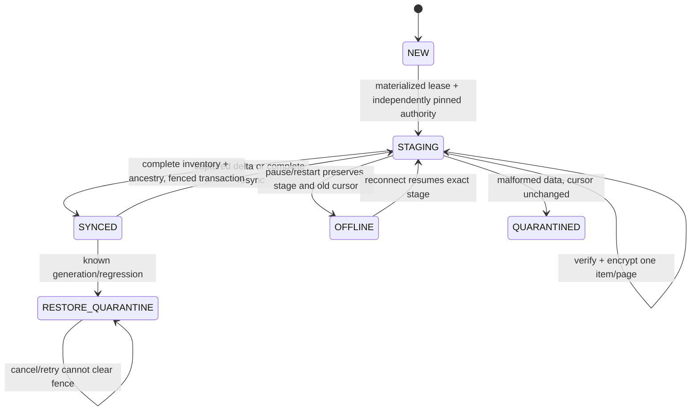

# P11 synchronization, offline durability and verification

P11 is **IN PROGRESS** pending a final browser regression investigation.
Initial code acceptance passed all twenty jobs at fae5e30. Public exact-source execution receipts are retained
in TEST_EVIDENCE and evidence/p11; physical and qualified review gates stay open.
Frozen P02 records, signatures, independent pins, provider eligibility,
TLS and CSP remain authoritative. See ADR-021.

The additive closed `p11-sync` transport exposes account/group-scoped sparse hints
over commit-ordered global positions. A page binds its input cursor, captured
watermark, actual scanned count and next position. Hidden rows count as scanned;
unscanned rows cannot be skipped. Query parsing uses the original query string to
reject duplicate, unknown and malformed parameters.

Resync materializes immutable group catalog and revision inventory under one SQL
read view and the GC coordination lock. Pins and pages commit before the descriptor
is returned. The frozen inventory commitment, exact operation retry, fixed thirty
minute lease and current account/device/session/group authorization apply to each
page/reference. Cancellation or expiry cleanup releases pins and ephemeral inventory;
it never purges encrypted content or signed ancestry. Export/collector are P13.

Protected portable and native control now reads legacy local frames and writes the
additive `p11-local-v1` profile. A root manifest references encrypted 256 KiB parts,
with exact index, byte count, digest, root pin and installation binding. The logical
cap is 32 MiB. A prepared private candidate group key stays in the encrypted root.
Committed secret inventory now uses the same encrypted part profile with a closed
10,000-key logical type. Account roster replay retains all signed events up to
10,000 / 32 MiB, while child frozen frames/signatures stay unchanged.

Old clients must refuse the new profile: this is an additive reader migration, not
a safe downgrade of an active installation. Existing signatures, private candidate
keys, independent pins, immutable outbox bytes and exact acknowledgement rules remain.

Snapshots and content deltas stage independently from the visible projection. They
reuse the existing content authority/decryption verifier. The durable cursor and
projection publish only in the final fenced local transaction. Partial application
survives restart, while missing pages, unverified content and storage abort prevent
advancement. A lower cursor or changed transport generation enters persistent
`RESTORE_QUARANTINE`; a newer unsigned server response cannot clear it.

Bounded cache compaction retains every signed header and witnessed ancestry. It
protects current heads and pending draft/outbox bases, works under the same atomic
lease fence, and permits exact historical payload download later. SQL/transaction
abort preserves the previous payload. It does not purge server content.

The notes UI has English/Russian sync controls and visible/online polling with five
second base interval, bounded jitter, fifteen-to-sixty-second failure backoff and
immediate reconnect/resume scheduling. Cooperative removal hides accessible views
after saving the dirty editor locally. Security hints request fresh signed authority
and a consistent snapshot; they never authorize a local mutation by themselves.
No continuous iOS background service is promised.

All twenty mandatory hosted jobs passed at `fae5e306181c05a9542449e8219706859f4b87a2`, full tree `630436bcfdfb2e7c3dbc4a52f80aba7f6b6a805a`.
Ten portable suites, seven actual native SQLite note suites/platform, nine new
native/portable interoperability checks/platform (1,001 signed roster events),
112 real sync HTTPS/SQL checks, 418 membership/authorization/lease checks and
45 sandboxed shipped-PWA checks passed. Inherited P02–P10 jobs remain passing.
The browser uses genuine WebAuthn, trusted CA/hostname TLS and strict CSP. Automatic
removal may conceal a group before manual Refresh; both timings must clear plaintext
DOM and preserve the actual encrypted unsent draft, including after local reopening.
Expired stages release the server lease before deleting its protected local reference;
a failed cancellation retains the reference and drafts for retry.

The complete installer and startup checks passed read-only with owned SQL state
preserved. Local cloud Chromium cannot start its required sandbox; mandatory hosted
execution provides browser evidence without disabling it. Physical G1 and qualified
G2/G3 remain open/NOT_RUN. No production deploy/restore/release is claimed.

The durable application and publication states are independent:

```mermaid
stateDiagram-v2
    [*] --> LOCAL_SAVED
    LOCAL_SAVED --> QUEUED: current authority, fresh immutable bytes
    QUEUED --> SENT_UNKNOWN: durable intent before network
    SENT_UNKNOWN --> SENT_UNKNOWN: receipt check or exact retry
    SENT_UNKNOWN --> COMMITTED: exact receipt and atomic matching draft retirement
    SENT_UNKNOWN --> CONFLICT: competing head or delete/edit
    SENT_UNKNOWN --> REKEY_REQUIRED: stale signed policy/epoch
    SENT_UNKNOWN --> ACCESS_LOST: remove/downgrade/revoke
    CONFLICT --> LOCAL_SAVED: explicit reviewed base, new attempt
    REKEY_REQUIRED --> LOCAL_SAVED: current proof + explicit publication
    ACCESS_LOST --> LOCAL_SAVED: owned private local copy; source retained
```

Owned recovery copies an unsent entry to a verified account-private thread with
fresh object/draft identity, no inherited server parents and no automatic upload.
It preserves the source draft and every pending immutable attempt. Explicit signed
restore is required for a tombstone; recovery does not resurrect its source object.
S01–S05 reuse the mandatory P09 fault/concurrent-device suite; S06–S12 add protected
snapshots, sparse ranges, revocation leases, compaction, migration and restore-fence
checks. P12/P13/P16 own file streaming, collector/export and operational restore.

## Acceptance mapping and boundaries

| Case | Actual software evidence | Remaining boundary |
| --- | --- | --- |
| S01 | Inherited P09 real protected restart/durable save plus P11 staged restart | Physical termination matrix remains G1/P14/P15 |
| S02–S03 | Inherited P09 exact immutable retry/changed-body denial; P11 snapshot operation retry and actual SQL fault rollback | No production fault injection |
| S04–S05 | Mandatory two-PWA P09 conflict/delete/edit/signed restore; P11 keeps independent drafts and attempts through resync | No automatic note-body merge or resurrection |
| S06 | Actual leased snapshot/write overlap, sparse following ranges; portable/native stage restart/atomic finish with retained outbox | Files/manifests are P12 |
| S07 | Three actual accounts/roles, reader denial and removal, leased-page reauthorization; owned local copy retains source/attempt | Old exposed keys/data remain exposed |
| S08 | Partial/forged/malformed pages, changed scope/root and omitted valid signed ancestry cannot advance cursor | A hint alone never grants authority |
| S09 | Actually enrolled second device revoked after lease; no continued page access, custody lock fences | Physical lock/suspend/cache erasure limits stay open |
| S10 | Real protected cache compaction/SQL abort, signed-header retention and exact payload redownload; cancelled-stage cleanup keeps drafts | Server collector/export is P13 |
| S11 | Additive part/profile migration, 661 committed keys, L rotation, restart/abort and old-reader refusal; trusted PWA reload retains sync | Physical iOS update/eviction remains P15 |
| S12 | Persistent known generation/regression fence blocks publication and survives cancel/reclassification/retry | Operational restored-server attestation/reconciliation is P16 |

Current resource bounds: 32 MiB logical encrypted control (128 parts), 10,000 keys
and complete signed roster events, 1,000 catalog groups, 50,000 snapshot revisions,
500 inventory items/1 MiB per page, eight active account leases and thirty minutes
fixed resync lifetime. Exhaustion fails explicitly and preserves the prior state.
Old signed frames/corpora remain unchanged. See ADR-021 for the additive transport
and local profile, and NEXT_TASK for the complete P12 handoff.

Follow-up lifecycle integration: a closed Worker custody reason now immediately
masks the host, terminates access and preserves encrypted state. Idle expiry and
clock regression retain the original five-minute/fail-closed guards and typed error
code. Background polling does not renew the host idle timer; only foreground work
or trusted visible input does. Final platform validation remains pending.
